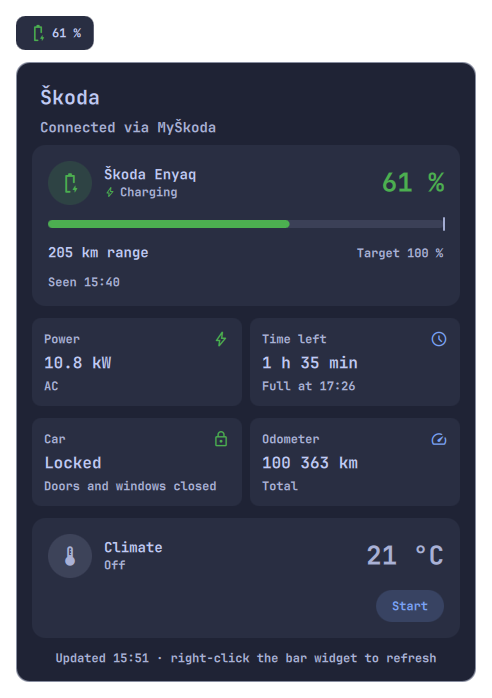
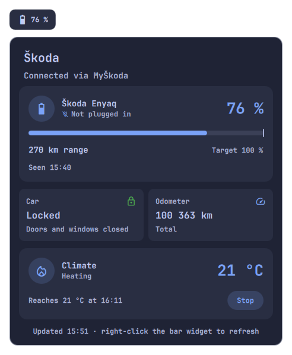

# duxskoda

Your Škoda in your [Dux Shell](https://github.com/duxlabs-dev/dux-shell) bar. The charge sits in the bar; click it for range, charging status, doors and locks, odometer, and the air conditioning, which you can start and stop from there.





It uses the official [MyŠkoda Public API](https://public.api.connect.skoda-auto.cz/docs): a free API key you create in the MyŠkoda app. No OAuth, no cloud account in the plugin. The API is for personal use only.

## Setup

1. In the MyŠkoda app (8.16 or newer) create an API key for your car. On a phone, https://go.skoda.eu/api-keys opens key management.
2. Save the key alone in `~/.config/skoda/token` and your car's VIN alone in `~/.config/skoda/vin`. Keep the key private: `chmod 600 ~/.config/skoda/token`.

Until both files exist the popup shows these steps and picks the files up by itself.

## Install (home-manager flakes)

Add the input and module:

```nix
# flake.nix
inputs.duxskoda = {
  url = "github:antonjah/duxskoda";
  inputs.nixpkgs.follows = "nixpkgs";
};

# in homeManagerConfiguration modules:
duxskoda.homeModules.default
```

Configure (all options except `enable` are optional):

```nix
programs.duxskoda = {
  enable = true;
  tokenFile = "~/.config/skoda/token"; # file with only your API key
  vinFile = "~/.config/skoda/vin";     # file with only your VIN
  refreshMinutes = 15;                 # 10, 15, 30 or 60
};
```

Add the widget to your bar. The plugin does not show up until you do this too: installing it does not place it. Add the entry to the widget list of your existing bar (`leftWidgets`, `centerWidgets` or `rightWidgets`); its place in the list is its place in the bar.

```nix
programs.dank-material-shell.settings.barConfigs = [{
  # ...your existing bar settings...
  rightWidgets = [
    # ...your existing widgets...
    { id = "duxSkoda"; enabled = true; }
  ];
}];
```

If your bar is not managed by Nix, add it in Dux instead: Settings > Bar widgets.

Rebuild and restart Dux, then enable the plugin once: Settings > Plugins, change the filter so disabled plugins are listed, and switch Škoda on. Or run `dms ipc call plugins enable duxSkoda`.

`programs.duxskoda.enable` only installs the plugin. Turning it on is a separate switch in Dux, kept out of Nix on purpose: declaring it there would make home-manager overwrite your other plugins' settings.

So three things are needed: the module (installs it), the bar entry (places it) and the switch in Dux (turns it on).

After updating the plugin, restart Dux again. "Reload plugin" keeps showing the old files.

## Air conditioning

The climate tile shows the state, the target temperature and when the cabin is expected to reach it. Press Start or Stop. The button only appears when your car reports that it supports the operation.

- Start uses the target temperature your car already has set, and it does not require the car to be plugged in unless the car's own setting says so.
- The car takes a while to answer. The tile shows "Starting…" until the car reports the new state, and the plugin makes one follow-up check about a minute later.

## Limits worth knowing

- **20 requests per hour per car**, shared with every other app using the same car (Home Assistant, for example). The plugin makes one request per refresh, backs off when the API says so (`Retry-After`, `RateLimit-*` headers), and right-click refresh is limited to once every 30 seconds.
- **Keys expire** and cannot be renewed from code. The popup warns 14 days ahead; create a new key in the app and overwrite the file.
- The data is what the car last reported to Škoda; "Seen" shows when. Parts your car does not support or could not report are left out, and the popup says so.
- One car (one VIN) per plugin.

## Development

```sh
nix develop                 # node, python, Xvfb
node --test 'tests/*.test.mjs'   # logic, against a redacted real API response
sh tests/render.sh          # renders every state headless against a mock server
```

`tests/render.sh` writes one PNG per scene to `tests/render-output` and checks the logged state. It runs in a private X server with temporary XDG dirs, so the running shell is untouched, and every process in it has a timeout. `DUXSKODA_ONLY="charging acstart" sh tests/render.sh` renders just those scenes.

`DUXSKODA_ONLY=real DUXSKODA_REAL_DIR=~/.config/skoda sh tests/render.sh` makes one read-only request to the real API with your own key and VIN and renders it. It never sends a command.
